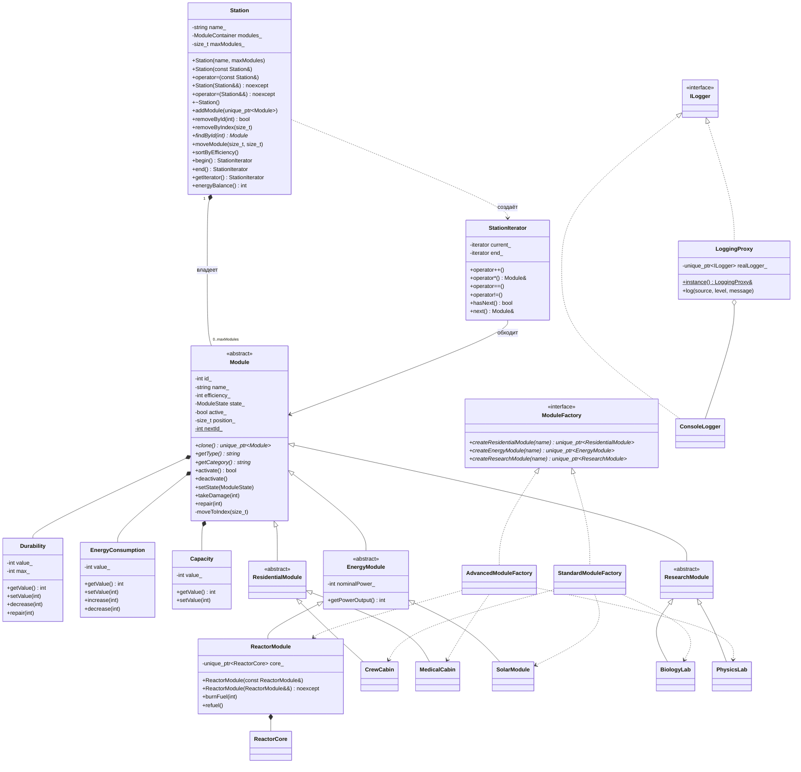

# Отчёт по лабораторной работе «Введение в ООП: классы, конструкторы, методы, наследование»

Проект: «Орбитальная станция». Язык реализации: C++17.

## Цель работы

Освоить основы ООП (классы, наследование, контейнеры) на примере системы управления орбитальной станцией и её модулями. Реализовать паттерн «Абстрактная фабрика» для создания модулей и итератор для обхода модулей станции.

## Структура проекта

| Файлы | Содержимое |
|---|---|
| `Durability.h/.cpp`, `EnergyConsumption.h/.cpp`, `Capacity.h/.cpp` | Классы-атрибуты модуля с валидацией |
| `Module.h/.cpp` | Абстрактный базовый класс `Module`, перечисление `ModuleState` |
| `ResidentialModules.h/.cpp` | `ResidentialModule` → `CrewCabin`, `MedicalCabin` |
| `EnergyModules.h/.cpp` | `EnergyModule` → `SolarModule`, `ReactorModule` (+ `ReactorCore`) |
| `ResearchModules.h/.cpp` | `ResearchModule` → `BiologyLab`, `PhysicsLab` |
| `ModuleFactory.h/.cpp` | `ModuleFactory`, `StandardModuleFactory`, `AdvancedModuleFactory` |
| `StationIterator.h/.cpp` | `StationIterator`, `ConstStationIterator` |
| `Station.h/.cpp` | Класс `Station` — контейнер модулей |
| `Logger.h/.cpp` | `ILogger`, `ConsoleLogger`, `LoggingProxy` |
| `Tests.h/.cpp` | Автотесты |
| `main.cpp` | Демонстрационные сценарии 1–5 и запуск тестов |

Во всех заголовочных файлах используется `#pragma once`.

## UML-диаграмма классов



## Описание классов

**Классы-атрибуты.** `Durability`, `EnergyConsumption` и `Capacity` — обёртки над `int` с приватным полем `value_`. У каждого есть конструктор по умолчанию и конструктор от `int`, а также `getValue()` и `setValue()` с проверкой: отрицательные значения запрещены, у `Durability` значение не может превышать максимум. `Durability::decrease/repair` и `EnergyConsumption::increase/decrease` не выводят значение за допустимые границы. Ресурсами эти классы не владеют, поэтому для них применяется правило нуля.

**Module.** Абстрактный базовый класс с полями `id`, `name`, `efficiency` (0–100, хранится прямо в модуле), `state`, `active`, `position` и тремя атрибутами. Уникальный `id` выдаётся из статического счётчика `nextId_`. Чисто виртуальные методы: `clone()`, `getType()`, `getCategory()`, `getCapacityUnit()`. Действия модуля:

- `activate()` / `deactivate()` — активировать можно только модуль в состоянии «включён»;
- `setState()` — фиксированные состояния `Enabled` («включён»), `Repair` («ремонт»), `Emergency` («авария»); при переходе в ремонт или аварию модуль деактивируется;
- `takeDamage()` / `repair()` — при нулевой прочности модуль переходит в аварию, после полного ремонта возвращается в «включён»;
- `moveToIndex()` — смена позиции; вызывается только станцией (`friend class Station`), чтобы позиция всегда совпадала с индексом в контейнере.

Копирующий и перемещающий конструкторы `Module` объявлены `protected`. Так модуль нельзя скопировать по ссылке на базовый класс (срезка исключена), а полиморфное копирование выполняется через `clone()`.

**Иерархия.** Три промежуточные категории: `ResidentialModule` (вместимость в людях), `EnergyModule` (вырабатывает энергию, вместимость — ёмкость аккумуляторов) и `ResearchModule` (вместимость в образцах). В каждой категории по две конкретные реализации, всего шесть классов. Каждая переопределяет `clone()` и `getType()`.

**Station.** Хранит модули в `std::vector<std::unique_ptr<Module>>`, лимит `maxModules_` задаётся в конструкторе (0 запрещён). Методы `addModule` (бросает `std::length_error` при превышении лимита), `removeById`, `removeByIndex`, `findById`, `at`, `moveModule`, `sortByEfficiency`, `energyBalance`, `print`.

## Паттерн «Абстрактная фабрика»

Интерфейс `ModuleFactory` объявляет три фабричных метода, по одному на категорию. Две конкретные фабрики выпускают согласованные семейства:

| Фабрика | Жилой | Энергетический | Исследовательский |
|---|---|---|---|
| `StandardModuleFactory` | `CrewCabin` | `SolarModule` | `BiologyLab` |
| `AdvancedModuleFactory` | `MedicalCabin` | `ReactorModule` | `PhysicsLab` |

Методы возвращают указатели на абстрактные категории (`ResidentialModule`, `EnergyModule`, `ResearchModule`), поэтому клиентский код не зависит от конкретных классов. Пример — функция `equipStation(Station&, const ModuleFactory&)` в `main.cpp`: она оснащает станцию модулями любого семейства, получив ссылку только на интерфейс. Чтобы добавить новое семейство, достаточно написать новую фабрику, не меняя `Station` и клиентский код.

## Паттерн «Итератор»

`StationIterator` хранит два итератора контейнера, `current_` и `end_`, и скрывает, что модули лежат в `unique_ptr`: разыменование сразу даёт `Module&`. Поддерживаются два способа обхода:

```cpp
for (Module& module : station) { module.activate(); }   // begin()/end(), operator++, *, !=

StationIterator it = station.getIterator();              // явный обход
while (it.hasNext()) { Module& module = it.next(); }
```

Для константной станции используется `ConstStationIterator`, который возвращают `begin() const` и `end() const`. `next()` за последним элементом бросает `std::out_of_range`. На собственном итераторе построены `Station::sortByEfficiency()` (сортировка выбором по убыванию эффективности) и `Station::energyBalance()`.

## Правило пяти

**Station:**

- конструктор копирования — глубокая копия: каждый модуль копируется через `clone()`;
- копирующее присваивание — проверяет самоприсваивание; модули сначала копируются во временный контейнер и только потом заменяют текущие (строгая гарантия безопасности исключений);
- конструктор перемещения и перемещающее присваивание (`noexcept`) — переносят вектор указателей, сами модули не копируются; станция-источник остаётся пустой;
- деструктор — `= default`: модули освобождаются автоматически через `unique_ptr`.

**ReactorModule** владеет динамическим ресурсом — активной зоной `std::unique_ptr<ReactorCore>`, поэтому для него тоже реализованы все пять методов. При копировании создаётся новая активная зона, при перемещении зона передаётся новому объекту.

У базового `Module` копирование и перемещение явно объявлены (`protected`). Счётчик `Module::copiesMade()` позволяет доказать в сценарии 3 и в тестах, что при перемещении копирования не происходит.

## Логирование

Все операции записываются через `LoggingProxy` (паттерн «Заместитель») с источниками `STATION`, `MODULE`, `FACTORY`. Заместитель создаёт реальный журнал `ConsoleLogger` при первой записи, фильтрует записи по источнику и уровню и нумерует их. Во время автотестов журнал отключается.

## Сборка и запуск

Visual Studio: «Файл → Открыть → Папка» и выбрать папку проекта (используется `CMakeLists.txt`). Из командной строки разработчика:

```
cl /std:c++17 /EHsc /W4 /utf-8 *.cpp /Fe:orbital_station.exe
```

Флаг `/utf-8` обязателен, без него русские строки выводятся некорректно. Программа собирается без предупреждений при `/W4`.

## Результаты сценариев

1. **Создание.** Станция «Заря» с лимитом 8 модулей; через обе фабрики добавлено 6 модулей. Список выведен через `getIterator()` и через range-based for.
2. **Копирование.** Скопировано 6 модулей, адреса первого модуля в оригинале и копии различаются. В копии модуль переименован и повреждён (прочность 70/100), один модуль удалён, один добавлен; оригинал остался без изменений. Показаны копирующее присваивание и безопасное самоприсваивание.
3. **Перемещение.** После конструктора перемещения у новой станции 6 модулей, у исходной — 0. Адрес первого модуля не изменился, копирований модулей — 0. Перемещающее присваивание передало и модули, и лимит (6/8), копирований — 0.
4. **Действия.** Все модули активированы (энергобаланс +45 кВт). Модули с эффективностью ниже 80% переведены в ремонт и не активируются повторно. Солнечный модуль получил критическое повреждение и перешёл в аварию, после полного ремонта снова включён и активирован. Исследовательский модуль деактивирован. Первый модуль перемещён в конец станции, затем модули отсортированы по эффективности (95, 90, 88, 85, 75, 70).
5. **Удаление и лимит.** Модули удалены по id и по индексу. Повторное удаление по тому же id возвращает `false`, неверный индекс приводит к `std::out_of_range`. Станция заполнена до 8/8, следующий `addModule` выбросил `std::length_error`; станцию с лимитом 0 создать нельзя (`std::invalid_argument`).

## Тестирование

`Tests.cpp` содержит 65 проверок в семи группах: классы-атрибуты (валидация и границы), модули (уникальность id, состояния, активация, выработка энергии), абстрактная фабрика (типы и категории продуктов обеих фабрик), правило пяти для `Station`, правило пяти для `ReactorModule`, итератор (range-for, `getIterator`, константный итератор, исключение в `next()`, постфиксный `++`), операции станции (лимит, поиск, перемещение, сортировка, удаление).

Результат: **пройдено 65, провалено 0**.

## Выводы

В работе реализована система управления орбитальной станцией на C++ с разделением на заголовочные файлы и файлы реализации. Иерархия из абстрактного класса, трёх категорий и шести конкретных модулей показывает наследование и полиморфизм; классы-атрибуты — инкапсуляцию и валидацию данных. Правило пяти для `Station` и `ReactorModule` вместе с `clone()` обеспечивает корректное глубокое копирование и дешёвое перемещение владеющих объектов, что подтверждено сценариями и тестами. Абстрактная фабрика отделила создание модулей от их использования, а собственный итератор дал единый способ обхода модулей, не раскрывая внутреннее устройство контейнера.
