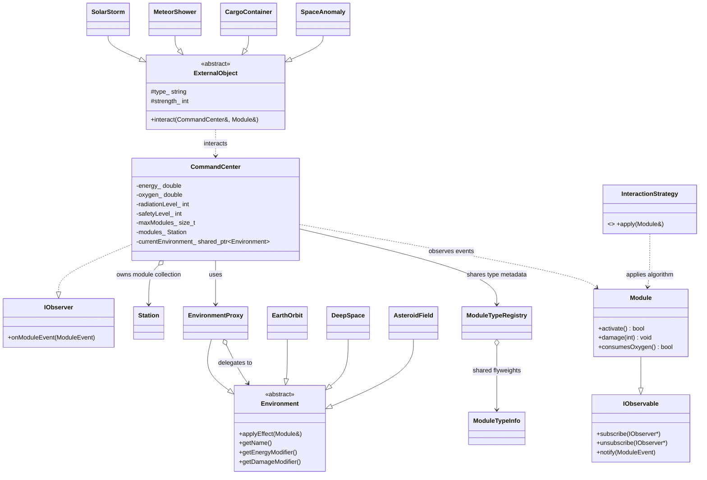

# Лабораторная работа №2. Командный центр, окружение и внешние объекты

**Язык:** C++17  
**Базовая система:** проект станции из лабораторной работы №1 (`Station`, `Module`, фабрики и семейства модулей).

## 1. Цель и общий результат

В работе реализована система управления космической станцией. Существующая модель модулей и фабрик из первой лабораторной работы сохранена и расширена командным центром, тремя типами окружения, внешними объектами, наблюдателями, стратегиями, прокси и логированием.

Командный центр не зависит от конкретных классов `SolarModule`, `CrewCabin`, `BiologyLab` и т. п. Он работает с базовым интерфейсом `Module`, а создание модулей делегирует абстрактной фабрике `ModuleFactory`. Специфичное поведение жилых модулей (потребление кислорода) вынесено в виртуальную возможность `consumesOxygen()`, поэтому добавление нового класса не требует изменения `CommandCenter`.

## 2. Этап 1 — проектирование архитектуры

На этапе спроектированы и подготовлены интерфейсы, абстрактные классы и взаимосвязи:

- `Environment` — контракт окружения: `applyEffect(Module&)`, `getName()`, `getEnergyModifier()`, `getDamageModifier()`.
- `EarthOrbit`, `DeepSpace`, `AsteroidField` — конкретные окружения.
- `ExternalObject` — абстрактное внешнее событие с `type_`, `strength_` и `interact(CommandCenter&, Module&)`.
- `SolarStorm`, `MeteorShower`, `CargoContainer`, `SpaceAnomaly` — четыре внешних объекта.
- `IObserver`, `IObservable`, `ModuleEvent` — контракт и данные для наблюдателя.
- `InteractionStrategy` — контракт алгоритмов влияния окружения на семейства модулей.
- `EnvironmentProxy` — заместитель окружения.
- `CommandCenter` — ресурсы, безопасность, вместимость, список модулей и текущее окружение.
- `ModuleTypeInfo` и `ModuleTypeRegistry` — разделяемые характеристики типов модулей по паттерну Flyweight.
- `ResourcePackage`, `Damage` и перегруженные `+`, `-`, `*`.

### UML / связи классов



### Выбор паттерна хранения — Flyweight

Для хранения общих характеристик выбран **Легковес (Flyweight)**, а не Composite: в постановке не требуется собирать модули в иерархические группы. `ModuleTypeRegistry` создаёт один `shared_ptr<const ModuleTypeInfo>` на тип. В `ModuleTypeInfo` находятся `maxHealth`, `baseEnergyConsumption`, `baseEfficiency`, `cost`; каждый экземпляр `Module` хранит ссылку на разделяемое описание. Состояние, прочность и текущее энергопотребление остаются индивидуальными.

## 3. Этап 2 — окружения и Strategy

Реализован чисто виртуальный `Environment`. Конкретные окружения работают через общий контракт, поэтому командному центру не нужно ветвиться по именам классов окружений.

### 3.1 EarthOrbit

- Возвращает нулевые модификаторы.
- Сбрасывает временный множитель энергопотребления к базовому.
- Снимает временную блокировку исследований.
- Записывает нейтральное воздействие в журнал с источником `ENV`.

### 3.2 DeepSpace

- Возвращает множитель энергопотребления `1.5`.
- При каждом применении наносит периодический урон.
- Передаёт обработку соответствующей стратегии семейства модуля.
- Энергопотребление рассчитывается от сохранённого исходного значения, а не умножается на уже изменённое значение. Повторное применение поэтому не приводит к экспоненциальному росту расхода.

### 3.3 AsteroidField

- Наносит урон прочности.
- Исследовательский модуль блокирует исследования и деактивирует.
- Реактор получает отдельный, меньший урон благодаря собственной стратегии.

### 3.4 Стратегии

`InteractionStrategy` задаёт `apply(Module&)`. Реализованы `EnergyModuleStrategy`, `CrewModuleStrategy`, `ResearchModuleStrategy`, `ReactorModuleStrategy`. Функция выбора проверяет `ReactorModule` до `EnergyModule`, поскольку реактор наследуется от энергетического модуля. Иначе реактор ошибочно получал бы общую энергетическую стратегию.

## 4. Этап 3 — внешние объекты и операторы

`ExternalObject` хранит тип и силу события. Его наследники изменяют станцию и модуль через интерфейсы командного центра и перегрузки операторов.

| Класс | Реализация воздействия |
|---|---|
| `SolarStorm` | Повышает уровень радиации командного центра, повреждает электронику и применяет отдельную стратегию к энергетическому, реакторному, жилому или исследовательскому модулю. |
| `MeteorShower` | Наносит физический урон через `Module - Damage`. |
| `CargoContainer` | Добавляет энергию, кислород и безопасность через `CommandCenter + ResourcePackage`. |
| `SpaceAnomaly` | Случайно телепортирует модуль, удваивает запас энергии или отключает модуль. Выбор вероятности зависит от уровня безопасности станции. |

`ResourcePackage` содержит `energy`, `oxygen`, `safetyLevel`. `Damage` содержит `amount` и `type` (`Radiation`, `Physical`, `Electrical`, `Unknown`).

Перегружены три операции:

- `CommandCenter& operator+(CommandCenter&, const ResourcePackage&)` — пополнение ресурсов.
- `Module& operator-(Module&, const Damage&)` — снижение прочности.
- `Module& operator*(Module&, double)` — умножение эффективности модуля с ограничением диапазона `0..100`.

Аномалия при эффекте удвоения энергии вызывает `operator*` для усиления характеристик модуля и удваивает энергетический запас командного центра. Для телепортации и отключения также используется оператор `*` с нейтральным множителем `1.0`, чтобы зарегистрировать модификацию и уведомить наблюдателей.

Для солнечной бури введён дополнительный интерфейс `ExternalInteractionStrategy`: одно событие выбирает разные алгоритмы в зависимости от семейства модуля.

## 5. Этап 4 — Observer, Proxy и LoggingProxy

### 5.1 Observer

`Module` реализует `IObservable`, а `CommandCenter` — `IObserver`. Модуль публикует события:

- `Activated` — успешная активация;
- `Damaged` — снижение прочности;
- `Destroyed` — прочность достигла нуля и модуль перешёл в аварию;
- `EnergyConsumed` — командный центр списал энергию за такт;
- дополнительно `Deactivated` и `Modified` — для полноты журнала.

`ModuleEvent` содержит `type`, `moduleId`, `damage`, `timestamp`. Для `EnergyConsumed` поле `damage` содержит количество списанной энергии, что сохраняет заданную структуру события и позволяет обойтись без отдельного типа события с дополнительным полем.

При `Damaged` командный центр уменьшает безопасность. При `Destroyed` ID попадает в очередь удаления. Фактическое удаление выполняется в `flushPendingRemovals()` после возврата из метода модуля/события. Это намеренно отложенное удаление: немедленное уничтожение `unique_ptr` прямо из callback уничтожило бы объект, чей метод `damage()` ещё выполняется.

Подписки перепривязываются при копировании и перемещении `CommandCenter`. Копия получает независимые клоны модулей; перемещённые модули отписываются от старого центра и подписываются на новый.

### 5.2 EnvironmentProxy

`EnvironmentProxy` хранит `std::shared_ptr<Environment> realEnvironment_`. Он:

1. отклоняет применение к разрушенному или аварийному модулю;
2. отдельно распознаёт исследовательский модуль и журналирует проверку;
3. формирует ключ кеша из ID модуля, окружения и снимка значимых характеристик;
4. пропускает повторное применение для идентичного снимка;
5. делегирует эффект реальному окружению.

Кеш принадлежит экземпляру Proxy, поэтому при смене окружения командный центр создаёт новый Proxy с новым кешем.

### 5.3 LoggingProxy

`LoggingProxy` оборачивает `Logger` и добавляет временную метку к каждой записи. Используется `ConsoleLogger`, внешние зависимости не требуются. Источники событий: `ENV`, `OBJECT`, `MODULE`, `CENTER`. Глобальный маршрут логирования используется окружениями и стратегиями; `CommandCenter::setLogger()` синхронизирует свой логгер с ним.

## 6. Этап 5 — интеграция и сценарии

`CommandCenter` хранит:

- `energy_` — общий запас энергии;
- `oxygen_` — запас кислорода;
- `radiationLevel_` — текущий уровень радиации;
- `safetyLevel_` — безопасность в диапазоне `0..100`;
- `maxModules_` — лимит количества;
- `modules_` — существующий контейнер `Station` с `unique_ptr<Module>`;
- `currentEnvironment_` — Proxy текущего окружения.

Создание выполняется через `ModuleFactory` и `ModuleCategory`; командный центр не зависит от конкретных типов фабричных модулей. Метод `tick()` списывает энергию у включённых модулей и кислород у модулей, у которых `consumesOxygen()` возвращает `true`.

### Демонстрационные сценарии

1. **Создание командного центра:** создание модулей через фабрику, установка `EarthOrbit`, применение нейтрального эффекта, вывод статистики.
2. **Смена окружения:** переход в `DeepSpace`, применение через Proxy, выбор стратегий, уведомления Observer, расход энергии и кислорода за такт.
3. **Солнечная буря:** рост радиации, повреждение модуля через `operator-`, уведомление командного центра.
4. **Грузовой контейнер:** поступление ресурсов через `operator+` и вывод обновлённой статистики.
5. **Космическая аномалия:** случайная ветка эффекта; высокий уровень безопасности повышает вероятность положительной реакции (удвоения энергии), низкий допускает телепортацию и отключение.

Дополнительно автоматические тесты проверяют физический урон метеоритного потока, все ветви аномалии, кеш Proxy, блокировку исследований, операторы, события наблюдателя и копирование/перемещение командного центра.

## 7. Проверка сборки и тестирования

Сборка использует CMake и стандарт C++17:

```bash
cmake -S . -B build -DCMAKE_BUILD_TYPE=Debug
cmake --build build --parallel
ctest --test-dir build --output-on-failure
```

Выполненная проверка в среде разработки:

- `station_core` — собрана статическая библиотека;
- `lab1_version2` — собран исполняемый файл, содержащий демонстрации ЛР1 и ЛР2;
- `lab2_tests` — собран тестовый исполняемый файл;
- CTest: **1/1 тест пройден**;
- демонстрационный исполняемый файл завершился с кодом `0`.

## 8. Вывод

Реализована интегрированная система второй лабораторной работы: командный центр управляет ресурсами и модулями, окружения воздействуют на модули через Strategy и Proxy, внешние объекты взаимодействуют через перегруженные операторы, а события модулей передаются командному центру через Observer. Общие сведения о типах модулей разделяются через Flyweight. Реализация использует C++17, раздельные `.h`/`.cpp`, `#pragma once`, ссылки для передачи объектов без копирования и Rule of Five для `CommandCenter`.
