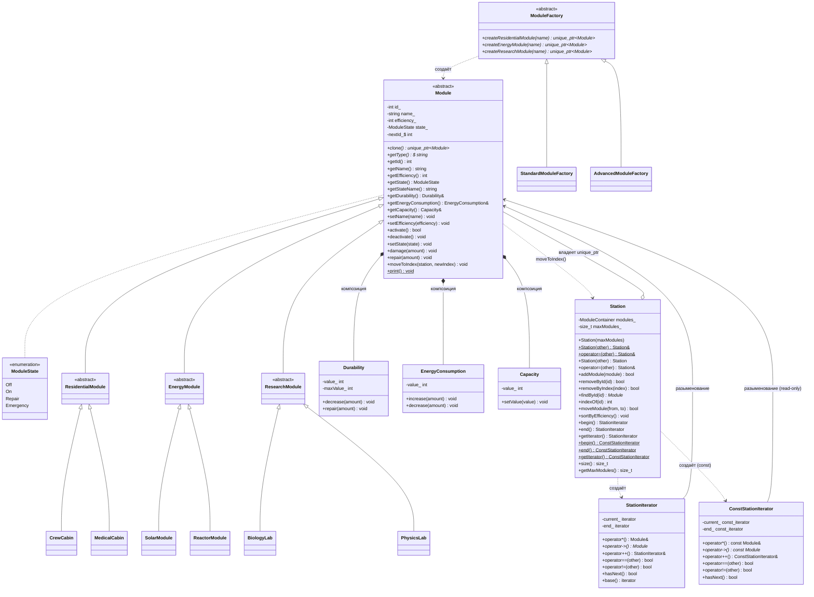

# Отчёт по лабораторной работе №1 «Орбитальная станция»

**Вариант 2** (lab1_version2)

Цель работы — спроектировать и реализовать систему «Орбитальная станция» 


---

## 1. Структура проекта

```text
lab1_version2/
├── CMakeLists.txt              # сборка (GLOB_RECURSE по src/, C++17)
├── REPORT.md                   # этот отчёт
├── include/                    # заголовки, подключаются от корня include/
│   ├── attributes/             # атрибуты модуля
│   │   ├── Capacity.h
│   │   ├── Durability.h
│   │   └── EnergyConsumption.h
│   ├── factories/              # абстрактная фабрика
│   │   ├── ModuleFactory.h     # абстрактный класс
│   │   ├── StandardModuleFactory.h
│   │   └── AdvancedModuleFactory.h
│   ├── modules/                # иерархия модулей
│   │   ├── Module.h            # абстрактный базовый класс
│   │   ├── ResidentialModule.h # промежуточный (жилые)
│   │   ├── EnergyModule.h      # промежуточный (энергетические)
│   │   ├── ResearchModule.h    # промежуточный (исследовательские)
│   │   ├── CrewCabin.h         # стандартный жилой
│   │   ├── MedicalCabin.h      # улучшенный жилой
│   │   ├── SolarModule.h       # стандартный энергетический
│   │   ├── ReactorModule.h     # улучшенный энергетический
│   │   ├── BiologyLab.h        # стандартный исследовательский
│   │   └── PhysicsLab.h        # улучшенный исследовательский
│   └── station/                # станция и итераторы
│       ├── Station.h
│       └── StationIterator.h   # StationIterator + ConstStationIterator
└── src/                        # реализации (зеркально include/)
    ├── main.cpp                # 5 демонстрационных сценариев
    ├── attributes/…            # по одному .cpp на атрибут
    ├── modules/…               # по одному .cpp на класс модуля
    ├── factories/…             # по одному .cpp на фабрику
    └── station/…               # Station.cpp, StationIterator.cpp
```


---

## 2. UML-диаграмма классов



---

## 3. Паттерны проектирования

### 3.1. Абстрактная фабрика (ModuleFactory)

- **Назначение.** Единый интерфейс создания модулей трёх категорий
  (жилой / энергетический / исследовательский), не привязанный к конкретным классам.
- **Участники.**
  - `ModuleFactory` — абстрактная фабрика с чисто виртуальными методами
    `createResidentialModule`, `createEnergyModule`, `createResearchModule`;
  - `StandardModuleFactory` — конкретная фабрика: `CrewCabin`, `SolarModule`, `BiologyLab`
    (дешевле, ниже эффективность);
  - `AdvancedModuleFactory` — конкретная фабрика: `MedicalCabin`, `ReactorModule`, `PhysicsLab`
    (прочнее и эффективнее);
  - `Station`/`main.cpp` — клиент: работает только с `Module` и `ModuleFactory`.
- **Результат.** Смена «поколения» оборудования станции сводится к подстановке
  другой фабрики; клиентский код не меняется. Каждый продукт возвращается как
  `std::unique_ptr<Module>` — владение сразу передаётся станции.

### 3.2. Итератор (StationIterator)

- **Назначение.** Последовательный обход модулей станции без раскрытия внутреннего
  представления (`std::vector<std::unique_ptr<Module>>`).
- **Участники.**
  - `StationIterator` — конкретный итератор: `operator*` отдаёт сам `Module&`
    (а не `unique_ptr`), `operator++`, `operator==`, `operator!=`, `hasNext()`;
  - `ConstStationIterator` — read-only-итератор для константных станций
    (`begin() const` / `end() const` / `getIterator() const`);
  - `Station` — агрегат с фабричными методами `begin()`/`end()`/`getIterator()`.
- **Результат.** Поддержаны и «ручной» обход (`hasNext()` + `operator++`), и
  range-based for (`for (Module& m : station)`), и обход константной станции.
  Сортировка `sortByEfficiency()` реализована через собственный итератор
  (сортировка выбором + `std::iter_swap` по `base()`).

---

## 4. Правило пяти (класс Station)

| Операция | Сигнатура | Реализация |
|---|---|---|
| Копирующий конструктор | `Station(const Station& other)` | глубокое копирование: каждый модуль копируется через `clone()` |
| Копирующее присваивание | `Station& operator=(const Station& other)` | проверка самоприсваивания; копия сначала строится во временном буфере (строгость по исключениям), затем переносится |
| Перемещающий конструктор | `Station(Station&& other) noexcept` | вектор модулей забирается целиком (`std::move`), у `other` остаётся пустой вектор |
| Перемещающее присваивание | `Station& operator=(Station&& other) noexcept` | проверка самоприсваивания; перенос вектора и лимита, `other` очищается |
| Деструктор | `~Station()` | `= default`: вектор сам уничтожает все `unique_ptr` |

Правило пяти соблюдается и на уровне модулей: копирование выполняется виртуальным
`clone()` (ковариантная глубокая копия конкретного класса), что делает копию станции
полностью независимой от оригинала.

---

## 5. Ключевые методы

- **`Station::addModule`** — добавляет модуль только если указатель непуст и лимит
  `maxModules_` не превышен, иначе `false`. Станция становится единственным
  владельцем модуля (`unique_ptr`).
- **`Station::removeById` / `removeByIndex`** — поиск и удаление; возвращают `false`
  для отсутствующего id и индекса за границами вектора.
- **`Station::findById` / `indexOf`** — поиск по id (указатель / индекс).
- **`Station::moveModule`** — перестановка модуля внутри станции через
  `std::rotate` (порядок остальных модулей сохраняется).
- **`Module::moveToIndex(station, index)`** — находит свой индекс по id и вызывает
  `station.moveModule`.
- **`Module::damage` / `repair`** — урон при прочности 0 переводит модуль в
  `Emergency`; ремонт из аварии переводит в `Repair` (не сразу во `On`).
- **`Module::activate`** — запрещает включение аварийного/сломанного модуля.

---

## 6. Демонстрационные сценарии (main.cpp)

Фактический вывод программы (`build/Release/lab1_version2.exe`):

### Проверка конструктора станции
`Station(0)` отклонён исключением `std::invalid_argument` — «Максимальное число
модулей должно быть положительным».

### Сценарий 1. Создание станции и модулей через разные фабрики
Создана станция с лимитом 5; добавлены 5 модулей от `StandardModuleFactory`
(CrewCabin, SolarModule, BiologyLab) и `AdvancedModuleFactory` (MedicalCabin,
ReactorModule). Список выведен дважды: через `getIterator()` + `hasNext()` и через
range-based for. Все модули получили последовательные id (1–5), корректные типы,
состояние «выключен» и характеристики своей фабрики.

### Сценарий 2. Копирование станции
- Адрес первого модуля оригинала `...4244F0` ≠ адрес в копии `...4245E0` —
  копия глубокая, объекты разные.
- В копии: переименование, `damage(40)` (прочность 60/100), удаление последнего
  модуля, добавление нового — состав копии изменился (3 модуля, id 6, 7, 9).
- Самоприсваивание (`station = station`) прошло без ошибок.
- Копирующее присваивание `assigned = original` — модулей 3, лимит 4.
- Оригинал не изменился: имя, прочность 100/100, 3 модуля — независимость подтверждена.

### Сценарий 3. Перемещение станции
- Адрес первого модуля до и после `Station moved(std::move(source))` совпадает
  (`...4A40`) — данные переезжают без копирования.
- Источник после перемещения пуст (0 модулей) и остаётся в корректном состоянии.
- Присваивание перемещением `target = std::move(moved)` перенесло 2 модуля.

### Сценарий 4. Состояния, перемещение модуля, сортировка
- `activate()` включил реактор; `deactivate()` выключил панель.
- `damage(150)` при прочности 150 → прочность 0, состояние «авария»;
  `activate()` в аварии отклонён.
- `repair(200)` → прочность восстановлена (150/150), состояние «ремонт»;
  `setState(On)` вернул модуль в работу.
- `moveToIndex(station, 0)` переставил реактор в начало списка.
- `sortByEfficiency()` упорядочил модули по убыванию эффективности: 95 → 75 → 70 → 60.

### Сценарий 5. Удаление и ограничение количества
- `removeById(существующий)` — модуль удалён; `removeById(999)` — «не найден».
- `removeByIndex(0)` — удалён; `removeByIndex(10)` — «индекс вне диапазона».
- Станция (лимит 3) заполнилась до 3/3; `addModule` сверх лимита вернул `false`
  («отказ — достигнут лимит модулей»).

Все сценарии завершены без ошибок, программа возвращает код 0.

---

## 7. Сборка и запуск

```powershell
cmake -S . -B build
cmake --build build --config Release
.\build\Release\lab1_version2.exe
```

Компилятор: MSVC 14.51 (Visual Studio 18 Community), стандарт C++17, флаг `/utf-8`.

---

## 8. Выводы

1. Реализована полная иерархия модулей (абстрактный `Module`, три категориальных
   промежуточных класса, шесть конкретных модулей) с атрибутами-композитами
   (прочность, энергопотребление, вместимость) и автоматической нумерацией id.
2. Класс `Station` демонстрирует правило пяти: глубокое копирование через
   `clone()`, безопасное присваивание копированием, дешёвое `noexcept`-перемещение.
3. Паттерн «Абстрактная фабрика» разделил создание стандартного и улучшенного
   оборудования от клиентского кода; паттерн «Итератор» дал единый обход станции
   (в том числе константный) и позволил реализовать `sortByEfficiency()`.
4. Демонстрационные сценарии подтвердили корректность всех узлов: правило пяти,
   работу итераторов и фабрик, валидацию атрибутов, машину состояний модуля,
   ограничения станции.
