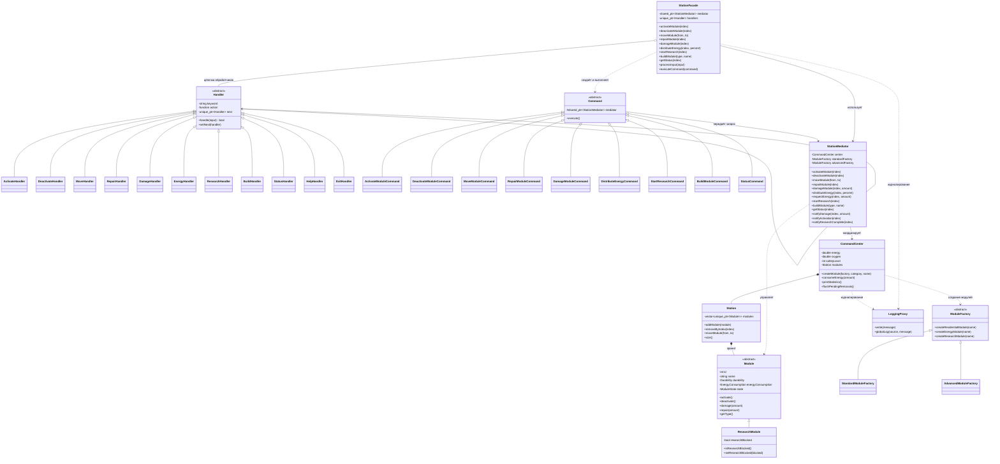
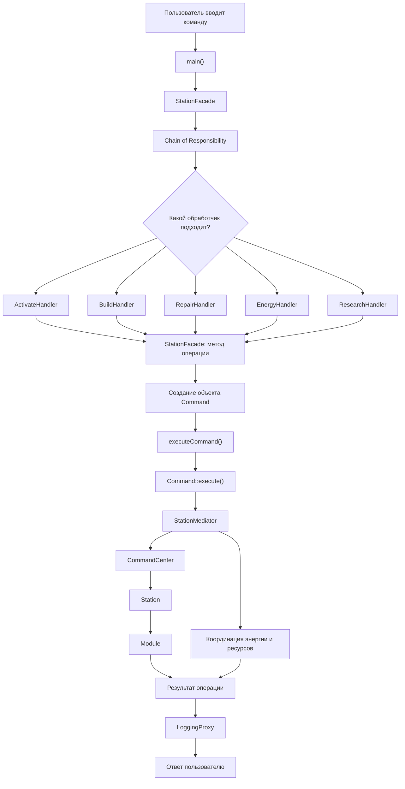

# UML — архитектура управления космической станцией

В этом документе представлены UML-диаграмма классов и схема взаимодействия паттернов проектирования, добавленных для управления космической станцией.

## 1. Диаграмма классов



## 2. Последовательность взаимодействия паттернов

Ниже показано, как проходит пользовательская команда `activate 0`.

В этом процессе участвуют все четыре реализованных паттерна:

1. **Цепочка обязанностей** определяет тип введённой команды.
2. **Фасад** предоставляет единую точку входа и организует выполнение операции.
3. **Команда** представляет действие пользователя отдельным объектом.
4. **Посредник** передаёт запрос в командный центр и управляет нужным модулем.

```
Diagram
    User->>Main: activate 0
    Main->>Facade: processInput(input)

    Note over Facade,Handler: Цепочка обязанностей

    Facade->>Chain: handle(input)
    Chain->>Handler: handle(input)
    Handler->>Handler: Разбор команды и индекса

    Note over Handler,Facade: Фасад и команда

    Handler->>Facade: activateModule(0)
    Facade->>Command: создать команду
    Facade->>Command: executeCommand(command)
    Facade->>Logger: Записать выполнение команды
    Command->>Command: execute()

    Note over Command,Module: Посредник

    Command->>Mediator: activateModule(0)
    Mediator->>Center: Получить модуль
    Center-->>Mediator: Ссылка на Module
    Mediator->>Module: activate()
    Module-->>Mediator: Результат активации

    opt Модуль успешно активирован
        Mediator->>Logger: Записать событие
    end

    Mediator-->>Command: Результат операции
    Command-->>Facade: Завершение выполнения
    Facade-->>Main: Результат
    Main-->>User: Модуль активирован
```

## 3. Общая цепочка взаимодействия



## 4. Роли паттернов

| Паттерн | Реализация | Назначение |
|---|---|---|
| Facade | `StationFacade` | Единый интерфейс управления |
| Chain of Responsibility | `Handler` и наследники | Разбор пользовательского ввода |
| Command | `Command` и наследники | Представление действий в виде объектов |
| Mediator | `StationMediator` | Координация взаимодействия компонентов |

## 5. Итог

Пользователь не обращается напрямую к модулям или командному центру.

Каждая команда проходит через обработчик пользовательского ввода, фасад и объект команды. Далее команда передаёт запрос посреднику, который взаимодействует с командным центром и нужными модулями.

Таким образом, четыре паттерна образуют единую цепочку, в которой каждый компонент отвечает за свою задачу.
